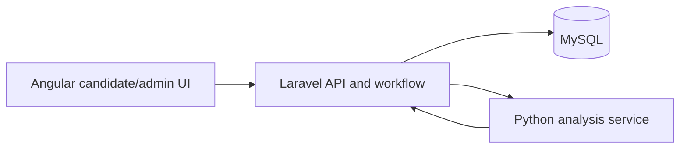

# HR AI Agent — End-to-End HR Workflow Automation

An MSc AI engineering project exploring automation across candidate screening, interviews, hiring decisions, onboarding, and leave management.

## Engineering scope

- **Frontend:** Angular
- **Backend:** Laravel
- **AI service:** Python
- **Database:** MySQL
- **Integration:** Laravel APIs connect workflow operations with a separate Python analysis service.

## Workflow

1. An administrator creates a job opening.
2. A candidate submits a resume.
3. The system scores resume/job-description similarity.
4. The candidate receives an interview invitation and records a video.
5. The interview is submitted for analysis.
6. The system combines assessment signals for a hiring recommendation.
7. Onboarding tasks and leave-related workflows follow.

## AI approach and limitations

Resume matching uses TF-IDF and cosine similarity. Some interview-analysis and speech-processing functionality was implemented as placeholders during the academic project; the repository should **not** be represented as a validated, fully automated hiring decision system. Any real deployment would require robust model evaluation, fairness testing, human review, privacy controls, and explicit consent for processing candidate recordings.

## Architecture



## Local development

The repository contains a `backend` directory and a `frontend` entry. Verify the frontend checkout and its own instructions before attempting a full-stack run.

For a conventional Laravel backend setup:

```bash
cd backend
composer install
cp .env.example .env
php artisan key:generate
php artisan migrate
php artisan serve
```

Configure database credentials and Python service connectivity as required by the application. This README does not claim the complete stack has been executed or tested.

## Engineering topics for interviews

Service boundaries, API orchestration, explainability of scoring, asynchronous media processing, audit logging, human-in-the-loop decision making, and operational safeguards for sensitive data.

## Status

Academic prototype. Do not use for consequential employment decisions without substantial validation and legal/privacy review.
